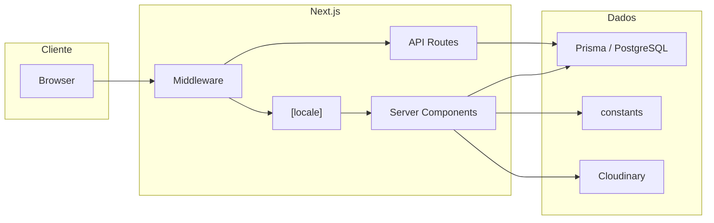

# Power Run — Visão técnica (CTO)

Site B2B da Power Run: catálogo de equipamentos fitness, multi-idioma, SEO por
cidade/produto, painel administrativo e analytics. Este documento resume
decisões de arquitetura e onboarding técnico.

## Stack

| Camada        | Tecnologia                         |
| ------------- | ---------------------------------- |
| Framework     | Next.js 15 (App Router), React 18  |
| Linguagem     | TypeScript                         |
| Dados         | Prisma 6, PostgreSQL               |
| i18n          | next-intl 4 — pt-BR, en, es, zh-CN |
| UI            | Tailwind CSS, Radix UI / ShadUI    |
| Monitorização | Sentry                             |
| Deploy        | Vercel (standalone, cron)          |

## Arquitetura (alto nível)



- **Middleware:** locale (next-intl), security headers, redirects. Rotas
  `/api/*` e sitemaps não passam por i18n.
- **Dados:** Catálogo (equipamentos, PDFs, linhas de produto) vive em
  **constants** (fonte de verdade). BD é usada para analytics (pageviews,
  sessões, conversões), admin (utilizadores) e logs de relatórios de marketing.
- **Imagens:** Next/Image com domínios remotos (Cloudinary, etc.) em
  `next.config.ts`.

## Dados

- **PostgreSQL (Prisma):** `AdminUser`, `PageView`, `QuoteClick`, `Session`,
  `TrafficSource`, `CustomEvent`, `PerformanceMetric`, `MarketingReportLog`. Ver
  `prisma/schema.prisma`.
- **Constants (sem BD):** `constants/equipment-data.ts`,
  `constants/product-lines/` (blue-line, red-line, musculacao),
  `constants/pdf-links.ts`, gym-kits, redirects, QR mapping. Usados em Server
  Components e geração de sitemaps.

## Quick start

```bash
npm install
# criar .env.local a partir de docs/ENV_EXAMPLE.md e ajustar variáveis
npx prisma generate
npx prisma migrate dev              # cria tabelas (ou migrate deploy em produção)
# Primeiro acesso ao painel: executar prisma/seed-data.sql OU npm run admin:init
npm run dev
```

Comandos úteis: `npm run build`, `npm run lint`, `npm test`,
`npm run admin:init` (criar primeiro admin), `npm run prisma:studio`. Dados
iniciais do BD: ver `prisma/seed-data.sql` e `docs/02-DATA-AND-PRISMA.md`.
Scripts de cidades/sitemaps: ver `docs/05-DEPLOY-AND-OPS.md`.

## Documentação técnica

| Documento                                                                    | Conteúdo                                                           |
| ---------------------------------------------------------------------------- | ------------------------------------------------------------------ |
| [docs/README.md](docs/README.md)                                             | Índice da documentação                                             |
| [docs/01-ARCHITECTURE.md](docs/01-ARCHITECTURE.md)                           | Stack, pastas, fluxo de request, sitemaps, imagens                 |
| [docs/02-DATA-AND-PRISMA.md](docs/02-DATA-AND-PRISMA.md)                     | Prisma, modelos, constants, migrações                              |
| [docs/03-API-REFERENCE.md](docs/03-API-REFERENCE.md)                         | API routes (tracking, admin, marketing, cron)                      |
| [docs/04-SECURITY-AND-ENV.md](docs/04-SECURITY-AND-ENV.md)                   | Segurança, env, Sentry                                             |
| [docs/05-DEPLOY-AND-OPS.md](docs/05-DEPLOY-AND-OPS.md)                       | Build, Vercel, CI/CD, scripts operacionais                         |
| [docs/06-PRODUTOS-IMAGENS-E-FICHAS.md](docs/06-PRODUTOS-IMAGENS-E-FICHAS.md) | Alterar imagens e informações técnicas dos produtos                |
| [docs/07-EMAIL-RELATORIO-MARKETING.md](docs/07-EMAIL-RELATORIO-MARKETING.md) | Configurar e-mail (SMTP) e destinatários do relatório de marketing |
| [docs/ENV_EXAMPLE.md](docs/ENV_EXAMPLE.md)                                   | Variáveis de ambiente (exemplo)                                    |
